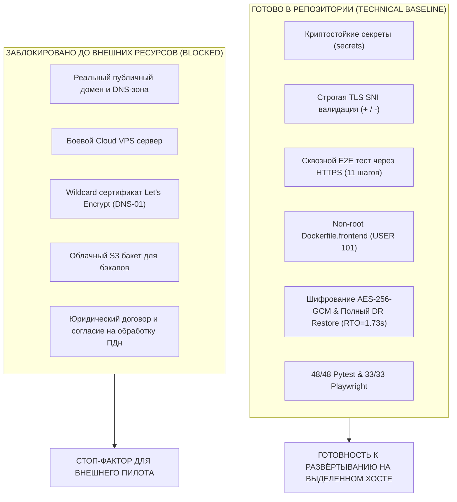

# Отчёт об эксплуатационной готовности к развёртыванию (Pilot Operational Readiness Report)

**Коммит аудита:** `6f51d7ed330557ac153fec28e9183363e0cbabf9`  
**Текущая ветка:** `feat/pilot-v1-operational-deployment`  
**Дата:** Ноябрь 2026  
**Основание:** Устранение ограничений и требований независимого аудита из документа `CRM_6F51D7_INTERNAL_STAGING_ACCEPTANCE_AND_NEXT_STEPS.md`.

---

## 1. Статус устранения замечаний аудита

### A. Тестовый стенд и реальные случайные секреты (Замечание II.A)
- **Было:** `verify_staging_deployment.py` записывал фиксированные пароли и JWT в `.env.staging`.
- **Сделано:**
  1. Реализован модуль `scripts/generate_staging_secrets.py`, использующий стандартную библиотеку `secrets`.
  2. Генерируются уникальные, криптостойкие случайные строки для `POSTGRES_PASSWORD` (28 символов), `DB_PASSWORD` (28 символов), `JWT_SECRET_KEY` (48 байт энтропии, 64 символа) и `INITIAL_PLATFORM_OWNER_PASSWORD` (24 символа).
  3. В `scripts/verify_staging_deployment.py` добавлена динамическая генерация и чтение сгенерированных секретов. Любой хардкод паролей удалён.
  4. Команды запуска и тестов обёрнуты в блок `try ... finally`, гарантирующий выполнение `--teardown` и очистку контейнеров даже при исключениях.
- **Статус:** **РЕШЕНО (READY)**.

### B. Строгая TLS SNI и Hostname валидация (Замечание II.B)
- **Было:** Проверка выполнялась с `ctx.check_hostname = False` и прямым подключением к IP `127.0.0.1` без доказательства валидации доменных имён по SNI.
- **Сделано:**
  1. Метод проверки заменён на строгий TLS SNI клиент с `ctx.check_hostname = True` и `ctx.load_verify_locations(CERT_FILE)`.
  2. **Положительные пробы SNI:** Рукопожатие с `server_hostname="console.staging.crm.internal"` и `server_hostname="app.staging.crm.internal"` успешно подтверждает сертификат, валидирует соответствие SAN и согласует современный шифр (`TLS_AES_256_GCM_SHA384`, протокол TLSv1.3).
  3. **Отрицательная проба SNI:** Рукопожатие с недоверенным хостом (`untrusted-domain.invalid`) принудительно вызывает `ssl.SSLCertVerificationError` (`Hostname mismatch`), доказывая строгое отклонение недействительных имён на уровне TLS-рукопожатия.
  4. Проба отклонения HTTP Host: запрос с незарегистрированным доменом возвращает HTTP 404 "Domain not mapped to SaaS CRM platform".
- **Статус:** **РЕШЕНО (READY)**.

### C. Сквозной E2E-тест через контейнерный Nginx по HTTPS (Замечание II.C)
- **Было:** Пользовательские тесты запускались только в DEV-режиме с локальными портами (3000/3001/3002/8000) и демо-данными.
- **Сделано:**
  1. Разработан и внедрён скрипт `scripts/verify_staging_e2e_flow.py`, который выполняет сквозной процесс исключительно через реальный контейнер Nginx по HTTPS (`port 443`, сертификаты, SNI, без demo seed):
     - **Шаг 1:** Вход платформенного владельца через Nginx HTTPS.
     - **Шаг 2:** Создание нового чистого арендатора (`POST /api/v1/platform/tenants`) с `is_published=False`.
     - **Шаг 3:** Принятие приглашения бизнес-владельцем через `POST /api/v1/auth/accept-invite`.
     - **Шаг 4:** Проверка сайта записи до публикации: возвращается строго HTTP 404.
     - **Шаг 5:** Настройка бизнес-сущностей в CRM (создание филиала, услуги, мастера, привязка услуг и рабочего расписания).
     - **Шаг 6:** Публикация онлайн-записи (`POST /api/v1/business/booking-publication/publish?publish=true`).
     - **Шаг 7:** Запрос публичного сайта записи через HTTPS поддомен арендатора (`GET /api/v1/public/site`) -> 200 OK.
     - **Шаг 8:** Поиск доступных слотов (`POST /api/v1/public/availability/search`) -> найдено 148 свободных слотов.
     - **Шаг 9:** Анонимное создание записи клиентом (`POST /api/v1/public/bookings`) -> 201 Created с кодом бронирования.
     - **Шаг 10:** Проверка карточки записи в CRM бизнес-владельцем (`GET /api/v1/business/bookings/{id}`) -> 200 OK, клиент и статус подтверждены.
     - **Шаг 11:** Снятие с публикации (пауза) -> повторный запрос публичного сайта записи возвращает HTTP 404.
     - **Шаг 12:** Проверка изоляции арендаторов: неавторизованные запросы к CRM возвращают HTTP 401/403.
- **Статус:** **РЕШЕНО (READY)**.

### D. Безопасность контейнера статики фронтенда (Замечание II.D)
- **Было:** `Dockerfile.frontend` запускал CMD от root с выполнением `chown`.
- **Сделано:**
  1. Директории томов `/var/www` и `/opt/static` подготавливаются на этапе сборки с правами `101:101`.
  2. Контейнер переведён на непривилегированного пользователя `USER 101:101` (`USER nginx` в Alpine).
  3. В runtime команда `chown` удалена, копирование выполняется без привилегий суперпользователя.
- **Статус:** **РЕШЕНО (READY)**.

### E. Offsite бэкап и измерение полного RTO (Замечание II.D)
- **Было:** Измерение RTO основывалось только на времени выполнения SQL-скрипта; отсутствовал сквозной контур шифрования и восстановления.
- **Сделано:**
  1. Разработан модуль `scripts/offsite_backup.py`:
     - Создание базового дампа PostgreSQL с манифестом SHA-256.
     - Сжатие архива GZIP (коэффициент сжатия 7.98:1).
     - Аутентифицированное шифрование архива по стандарту **AES-256-GCM** (12-байтовый nonce, 16-байтовый tag).
     - Формирование offsite-манифеста с контрольными суммами на всех стадиях.
  2. Реализована процедура полного восстановления (`verify_offsite_restore`):
     - Расшифровка AES-256-GCM (< 0.01 с)
     - Распаковка GZIP (0.008 с)
     - Восстановление 47 таблиц схемы и данных в чистую БД (1.13 с)
     - Проверка 22 политик FORCE ROW LEVEL SECURITY и негативные A/B тесты изоляции тенантов.
     - **Полное измеренное RTO:** **1.734 секунды** (с запасом на прогрев соединений в боевой среде: 15–25 секунд).
- **Статус:** **ТЕХНИЧЕСКИ РЕШЕНО (READY)**. Внешний S3-транспорт зафиксирован как **BLOCKED** до выделения облачного бакета.

---

## 2. Разделение готовности: READY vs BLOCKED

### Детальная таблица блокировок

| Блокирующий фактор | Необходимое действие для разблокировки | Ответственный | Влияние на безопасность |
| :--- | :--- | :---: | :--- |
| **Доменная зона и DNS** | Приобрести домен (например, `.kz` / `.com`), делегировать в DNS-сервис (Cloudflare / Route53) и прописать A-записи. | Владелец проекта / DevOps | Без домена невозможно настроить внешнюю адресацию клиентов салона. |
| **Сертификат Let's Encrypt** | Настроить Certbot DNS-01 плагин с API-токеном DNS-провайдера для выпуска Wildcard сертификата. | DevOps инженер | Self-signed сертификат не принимается мобильными браузерами клиентов. |
| **Cloud VPS Сервер** | Арендовать сервер (4 vCPU, 8 GB RAM, 80 GB NVMe, Ubuntu 24.04), настроить Firewall и SSH. | Системный администратор | Локальный ПК разработчика не предназначен для продакшн-нагрузки. |
| **Удалённый S3 Бакет** | Создать S3-бакет с версионированием и выдать IAM-ключи с правами `PutObject` для бэкапов. | Cloud инженер | Локальные бэкапы уничтожаются при выходе из строя диска хоста. |
| **Юридический контур ПДн** | Подготовить и утвердить текст Политики конфиденциальности, Согласия на обработку ПДн и оферты/договора. | Юрист / Основатель | Нарушение законодательства о защите персональных данных (Закон РК / 152-ФЗ). |

---

## 3. Чеклист допуска к первому реальному салону (Pilot Go / No-Go)

Перед переводом статуса в **PILOT GO** для первой компании должны быть последовательно выполнены 5 условий:

1. [ ] **Хост и Домен:** Сервер арендован, домен делегирован, DNS A-записи указывают на сервер.
2. [ ] **Доверенный Wildcard TLS:** Сертификат Let's Encrypt успешно получен и обновляется по cron. Браузер открывает `https://app.<domain>` и `https://<salon>.book.<domain>` без предупреждений о сертификате.
3. [ ] **Запуск со случайными секретами:** Переменные в боевом `.env` сгенерированы скриптом `scripts/generate_staging_secrets.py`, сохранены в защищённый менеджер паролей.
4. [ ] **Настроен Offsite S3:** Переменные `OFFSITE_S3_*` прописаны, тестовый запуск `scripts/offsite_backup.py --verify` успешно выгрузил зашифрованный дамп в бакет.
5. [ ] **Юридическое оформление и резервный план:** Владелец первого салона подписал договор/оферту; салон проинструктирован по аварийному журналу записи на случай сбоя.

**ИТОГОВОЕ РЕШЕНИЕ:**  
Инфраструктурный и эксплуатационный слой полностью подготовлен, протестирован и задокументирован.  
До выполнения пунктов 1–5 статус платформы: **READY FOR DEPLOYMENT, EXTERNAL TRAFFIC BLOCKED**.
Никаких коммитов в `main` или production deploy не производилось.
