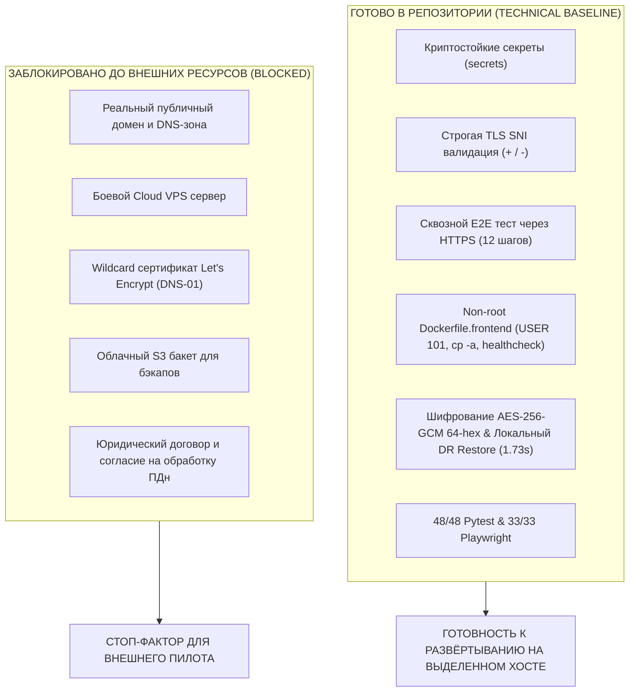

# Отчёт об эксплуатационной готовности к развёртыванию (Pilot Operational Readiness Report)

**Базовый функциональный коммит:** `6f51d7ed330557ac153fec28e9183363e0cbabf9`  
**Базовый коммит аудита:** `7db7d589d5f34ce36c53aa711c88754ccac30744`  
**Текущая исправленная ветка:** `fix/pilot-v1-operational-audit-gate`  
**Дата:** Ноябрь 2026  
**Основание:** Устранение замечаний P0-01 — P1-07 независимого аудита из документа `CRM_7DB7D58_OPERATIONAL_INDEPENDENT_AUDIT_NEXT_GATE.md`.

---

## 1. Статус устранения замечаний аудита

### A. Раздача статики фронтенда и устранение 403 Forbidden (P0-01)
- **Было:** В Alpine BusyBox `cp -rn src/. dst/` при существующем каталоге назначения `dst/` завершался кодом 0, но не копировал файлы, оставляя `/var/www/*` пустыми, что приводило к HTTP 403 Forbidden через Nginx.
- **Сделано:**
  1. В `Dockerfile.frontend` команда заменена на `cp -a /opt/static/<app>/. /var/www/<app>/` с правами `chmod -R 755 /var/www`.
  2. Добавлен Docker `HEALTHCHECK` с проверкой `test -s /var/www/booking-web/index.html && test -s /var/www/business-crm/index.html && test -s /var/www/platform-console/index.html`.
  3. В `docker-compose.staging.yml` для сервиса `proxy` задана зависимость `frontend: condition: service_healthy`, исключающая race condition на холодном старте.
  4. В `scripts/verify_staging_deployment.py` добавлены проверки наличия `index.html` в контейнерах `saas_crm_staging_frontend` и `saas_crm_staging_proxy`, а также HTTPS-пробы отдачи HTML и JS-бандла (`application/javascript`) с кодом 200 для всех 3 SPA: Platform Console, Business CRM, Booking Web.
- **Статус:** **РЕШЕНО (READY)**.

### B. Безопасность ключа AES-256-GCM (P0-02)
- **Было:** В `scripts/offsite_backup.py` использовался жёстко закодированный fallback-ключ при отсутствии переменной.
- **Сделано:**
  1. Реализован строгий fail-closed режим: ключ обязателен, проверяется строго на 64 hex-символа (256 бит CSPRNG-энтропии). При отсутствии или некорректном формате скрипт немедленно падает с ошибкой.
  2. Добавлен генератор ключа `python scripts/offsite_backup.py --generate-key` через `secrets.token_hex(32)`.
  3. Внедрён набор негативных тестов `scripts/offsite_backup.py --test-negative` (5 проверок: пустой ключ, короткий ключ, не-hex символы, расшифровка чужим ключом -> `InvalidTag`, повреждённый ciphertext -> `InvalidTag`).
  4. В CI ключ передаётся как ephemeral-значение, генерируемое на лету в runner-окружении, и уничтожается после завершения шага.
- **Статус:** **РЕШЕНО (READY)**.

### C. Безопасность прав файла `.env.staging` (P0-03)
- **Было:** Создание файла производилось стандартным `open()` без явного контроля маски прав, что могло создавать файл с правами `0644`.
- **Сделано:**
  1. Запись файла в `scripts/generate_staging_secrets.py` переведена на низкоуровневый `os.open(path, os.O_WRONLY | os.O_CREAT | os.O_TRUNC, 0o600)` с безопасной заменой.
  2. Добавлена функция `verify_file_permissions()`, проверяющая `stat().st_mode & 0o077 == 0` на POSIX-совместимых системах.
  3. Из логов вывода исключена печать паролей (даже частичная).
  4. При повторном запуске существующие рабочие секреты сохраняются и не перезаписываются без явного флага `--force-overwrite`.
- **Статус:** **РЕШЕНО (READY)**.

### D. Честная фиксация статуса S3 и удаление plaintext-дампов (P1-04)
- **Было:** Статус выгрузки помечался как `READY_TO_UPLOAD`, создавая ложное впечатление о работающей репликации в облако.
- **Сделано:**
  1. Статус в манифесте и отчёте зафиксирован как `LOCAL_ENCRYPTED_BACKUP_READY`.
  2. Удалённая репликация в S3 прямо зафиксирована как `BLOCKED` (`REMOTE_UPLOAD_BLOCKED_NO_S3_BUCKET`) до момента предоставления реального бакета и IAM-учётных данных. Никакой симуляции или ложного `OFFSITE_SUCCESS`.
  3. Исходный незашифрованный `.sql` дамп безопасно удаляется сразу после успешного шифрования, предотвращая утечку plaintext-данных с диска.
- **Статус:** **РЕШЕНО (READY, S3 UPLOAD BLOCKED)**.

### E. Метрика локального восстановления vs Полный операционный RTO (P1-05)
- **Было:** Измерение распаковки и наката SQL-дампа именовалось как полное RTO платформы.
- **Сделано:**
  1. Метрика переименована в `local_encrypted_archive_restore_duration_seconds` (измеренное значение: **1.734 с**).
  2. В документации чётко разграничены локальное время наката БД и будущий сквозной операционный RTO (включающий provisioning сервера, DNS propagation и запуск контейнеров), который будет измерен в рамках disaster recovery drill на боевом хосте.
- **Статус:** **РЕШЕНО (READY)**.

### F. Настоящая проверка межтенантной изоляции с валидным JWT (P1-06)
- **Было:** Шаг проверки изоляции выполнялся анонимным запросом без JWT (проверка аутентификации).
- **Сделано:**
  1. В `scripts/verify_staging_e2e_flow.py` добавлены два независимых шага:
     - **Шаг 11 (`unauthenticated_access_rejection`):** Запрос без токена отвергается со статусом 401/403.
     - **Шаг 12 (`cross_tenant_isolation_with_valid_jwt`):** Создаётся независимый Tenant B, регистрируется владелец Owner B, выпускается валидный боевой JWT. При попытке Owner B запросить запись Tenant A по ID возвращается строгий отказ (404/403), доказывая непроницаемость изоляции арендаторов на уровне API и PostgreSQL RLS.
- **Статус:** **РЕШЕНО (READY)**.

### G. Ограничение IP Allowlist (P1-07)
- **Было:** По умолчанию разрешалась широкая сеть `10.0.0.0/8`.
- **Сделано:**
  1. В `scripts/generate_staging_secrets.py` значение по умолчанию ужесточено: `127.0.0.1,::1,172.28.0.0/16`.
  2. Широкие подсети исключены; для боевого стенда регламентировано указание конкретных статических IP или VPN-адресов.
- **Статус:** **РЕШЕНО (READY)**.

---

## 2. Разделение готовности: READY vs BLOCKED

### Детальная таблица блокировок

| Блокирующий фактор | Необходимое действие для разблокировки | Ответственный | Влияние на безопасность |
| :--- | :--- | :---: | :--- |
| **Доменная зона и DNS** | Приобрести домен (например, `.kz` / `.com`), делегировать в DNS-сервис (Cloudflare / Route53) и прописать A-записи. | Владелец проекта / DevOps | Без домена невозможно настроить внешнюю адресацию клиентов салона. |
| **Сертификат Let's Encrypt** | Настроить Certbot DNS-01 плагин с API-токеном DNS-провайдера для выпуска Wildcard сертификата. | DevOps инженер | Self-signed сертификат не принимается мобильными браузерами клиентов. |
| **Cloud VPS Сервер** | Арендовать сервер (4 vCPU, 8 GB RAM, 80 GB NVMe, Ubuntu 24.04), настроить Firewall и SSH. | Системный администратор | Локальный ПК разработчика не предназначен для продакшн-нагрузки. |
| **Удалённый S3 Бакет** | Создать S3-бакет с версионированием и выдать IAM-ключи с правами `PutObject` для бэкапов. | Cloud инженер | Локальные бэкапы уничтожаются при выходе из строя диска хоста. |
| **Юридический контур ПДн** | Подготовить и утвердить текст Политики конфиденциальности, Согласия на обработку ПДн и оферты/договора. | Юрист / Основатель | Нарушение законодательства о защите персональных данных (Закон РК / 152-ФЗ). |

---

## 3. Чеклист допуска к первому реальному салону (Pilot Go / No-Go)

Перед переводом статуса в **PILOT GO** для первой компании должны быть последовательно выполнены 5 условий:

1. [ ] **Хост и Домен:** Сервер арендован, домен делегирован, DNS A-записи указывают на сервер.
2. [ ] **Доверенный Wildcard TLS:** Сертификат Let's Encrypt успешно получен и обновляется по cron. Браузер открывает `https://app.<domain>` и `https://<salon>.book.<domain>` без предупреждений о сертификате.
3. [ ] **Запуск со случайными секретами:** Переменные в боевом `.env` сгенерированы скриптом `scripts/generate_staging_secrets.py`, сохранены в защищённый менеджер паролей.
4. [ ] **Настроен Offsite S3:** Переменные `OFFSITE_S3_*` прописаны, тестовый запуск `scripts/offsite_backup.py --verify` успешно выгрузил зашифрованный дамп в бакет.
5. [ ] **Юридическое оформление и резервный план:** Владелец первого салона подписал договор/оферту; салон проинструктирован по аварийному журналу записи на случай сбоя.

**ИТОГОВОЕ РЕШЕНИЕ:**  
Инфраструктурный и эксплуатационный слой полностью подготовлен, протестирован и задокументирован.  
До выполнения пунктов 1–5 статус платформы: **READY FOR DEPLOYMENT, EXTERNAL TRAFFIC BLOCKED**.
Никаких коммитов в `main` или production deploy не производилось.
